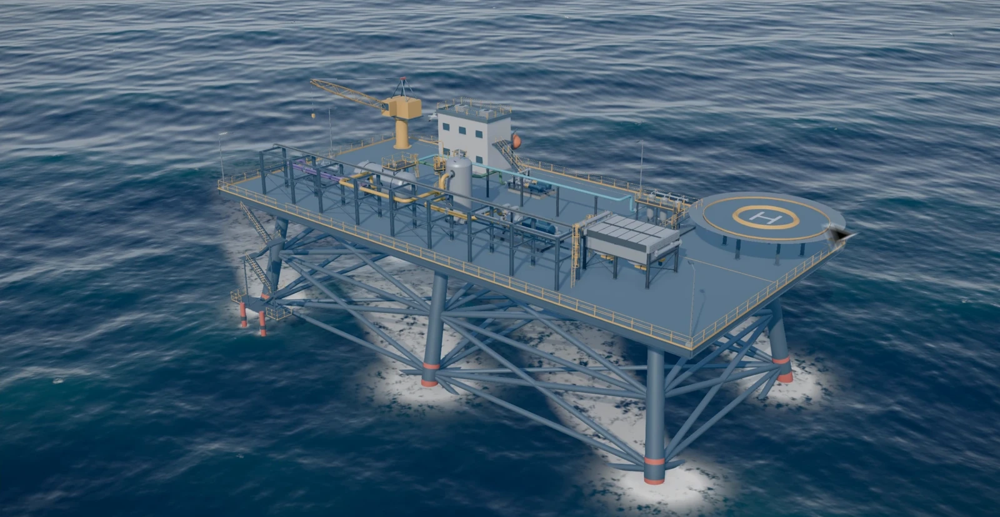

# TrazIA-3D

## Equipo

- **Javier Saguar Antona**
- **Iria Lozano Carrasco**
- **Miguel Vera del Castillo**
- **Alejandro Cuevas Cid**

**Del plano industrial al modelo 3D, con cada cota trazada.** Proyecto del reto **GA2MODEL de Técnicas Reunidas** en **IndesIAhack 2026**.

La imagen muestra **SIM-MAR**, una plataforma petrolífera sintética con equipos, líneas de proceso y un plano navegable desde el visor.

## Qué hace

En ingeniería, el mismo equipo pasa por varias revisiones del plano. TrazIA-3D lee un plano de disposición general (GA) y su hoja de datos mecánicos (HDM), construye un **IFC4 en borrador** y conserva el vínculo entre las medidas del modelo y sus fuentes. El ingeniero puede revisar el PDF y el IFC lado a lado y aprobar una revisión cuando ha comprobado los datos.

| Paso | Qué aporta |
| --- | --- |
| **Leer** | Extrae cotas, tablas y marcas mediante reglas y OCR. La visión puede proponer los valores que requieren revisión. |
| **Modelar** | Genera geometría paramétrica con identificadores estables para conservar la identidad de cada pieza entre revisiones. |
| **Revisar** | Muestra la evidencia por documento, página y región. Señala los cambios y los campos que requieren comprobación. |
| **Proponer y aprobar** | El copiloto vincula sus respuestas al proyecto y permite proponer cambios por texto o voz, según la configuración. La aprobación corresponde a una persona y caduca si cambian los datos. |

## Prueba la demo

Con Node.js 22.12 o posterior y Corepack, desde la raíz:

```bash
cd web
corepack pnpm install --frozen-lockfile
corepack pnpm dev
```

Abre [http://localhost:3000](http://localhost:3000). La portada ofrece el **V-101** para explorar la transición del boceto al IFC. En [Documentos → Proyectos](http://localhost:3000/documentos?vista=proyectos), abre la **Plataforma marina de producción** para ver el plano y el modelo en paralelo. Selecciona el aeroenfriador **E-140** para localizar sus datos en el plano. También se incluyen una planta de tratamiento de gas, un terminal costero de almacenamiento y una ampliación de refinería.

La demo web usa los ejemplos sintéticos incluidos y arranca sin claves. En **Documentos → Equipos**, cada tarjeta reúne las versiones del equipo, sus planos y una miniatura cuando tiene IFC.

## API y procesamiento local

Con Python 3.12 y [uv](https://docs.astral.sh/uv/), desde la raíz:

```bash
uv sync --frozen --extra dev --extra ocr --extra geo --extra api
uv run python -m trazia.api
```

La API publica su contrato en [localhost:8000/docs](http://localhost:8000/docs). Para comprobar la exportación con un ejemplo incluido:

```bash
uv run trazia export examples/vessel_rev_b.json --draft -o generated/rev_b.ifc
```

Para procesar tus propios documentos, colócalos en `data/` y ejecuta `uv run trazia lote data -o generated/lote`. El lote guarda resultados y candidatos con sus citas para que se puedan revisar los campos pendientes.

## Tecnología y código

- [**Backend y geometría**](src/trazia/) · Python, FastAPI, reglas de extracción, OCR e IfcOpenShell.
- [**Aplicación web**](web/) · Next.js, React, TypeScript, Three.js y web-ifc.
- [**Evaluación**](bench/) · Medición de cobertura, evidencia, tiempos y generación de IFC.
- [**Material de presentación**](pitch/) · Presentaciones del jurado y del track técnico.

Este repositorio parte del commit `59426c1` de GitLab e incluye el código y los ejemplos sintéticos. Los documentos, modelos de referencia y datos de evaluación internos se gestionan en el entorno original.

[Licencia MIT](LICENSE) · [Dependencias y licencias de terceros](THIRD_PARTY.md)
