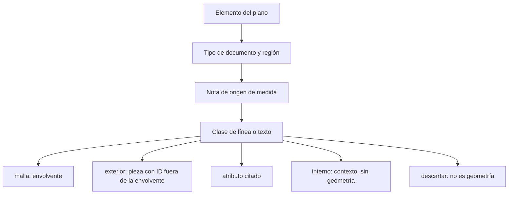

# Convenciones de lectura de las vistas · qué entra en el IFC y qué no

Esta guía dice, elemento a elemento, qué parte de un GA entra en la geometría exterior del IFC, qué
se guarda solo como atributo y qué se descarta. Aplica a recipientes verticales y horizontales,
columnas y tanques. Se apoya en las normas de dibujo, en la práctica de recipientes a presión y en
lo que ya se ha medido en los planos de TR ([PLAN.md](PLAN.md) y el oro de
[eval/verdad/](../eval/verdad/)). No copia ningún plano: los valores de ejemplo son los que ya
están publicados en esos dos sitios.

Es la especificación de la que saldrán `lectura/soldaduras.py`, el mapa de lámina y el bloque de
relevancia del prompt `CAMPOS` ([src/trazia/vision/prompts.py](../src/trazia/vision/prompts.py)).

## 1. Para qué sirve

El IFC de TrazIA reconstruye la envolvente exterior: virola, fondos, soporte y boquillas, más las
costuras si el plano las sitúa. Tiene que coincidir con el alzado y la planta, no con todo lo que
hay impreso en la lámina. Un GA de columna muestra platos, anillos de soporte, bajantes,
distribuidores y tuberías vecinas. Casi nada de eso forma parte de la silueta, y leerlo como si lo
fuera produce virolas más largas, boquillas falsas o diámetros equivocados.

Desde el feedback de los mentores del 25/11 ([PLAN.md §1.3](PLAN.md)) hay una segunda exigencia:
**toda pieza exterior documentada debe aparecer con su ID**, con geometría si el plano da cotas o
como pendiente si no las da. La guía distingue por eso cinco acciones, no tres (sección 4).

## 2. Qué manda en cada decisión

Orden fijo. La nota del propio plano gana a la norma.

1. **Tipo de documento.** El GA (alzado, planta, vista de extremo, secciones de orientación) define
   la forma. La HDM aporta tablas y atributos, no una vista. El VESOR solo orienta en planta. Un
   detalle local (silleta, soldadura, placa, pescante) no sustituye la envolvente del GA.
2. **Cajetín:** unidades, escala de cada vista, símbolo de proyección y revisión (ISO 7200). Sin
   Norte ni sentido de giro declarados no hay azimut: es la regla que ya aplica `internal_azimuth`
   en [src/trazia/reference.py](../src/trazia/reference.py).
3. **Conjunto de IDs**, solo desde las tablas ([PLAN.md §3.2](PLAN.md)).
4. **Notas que cambian el origen de medida:** T.L. o B.T.L., T.O.S., EL absoluta o relativa,
   proyección desde el eje o desde la virola, diámetro interior o exterior, sentido horario. En
   BF-V-0016 la nota N4 fija la proyección de la cara de brida al eje; el oro ya guarda
   `standout_base`.
5. **Grafismo de la vista**, clasificado antes de usarlo (secciones 5 y 8).



## 3. Qué necesita la industria de un modelo de equipo

El modelo 3D de un equipo estático no se usa para fabricarlo: para eso están el GA y los planos de
detalle del fabricante. Se usa para diseñar lo que se conecta a él. De ahí sale la prioridad.

| Quién lo usa | Qué necesita del equipo | Qué no necesita |
| --- | --- | --- |
| Tuberías (*piping*) | Cada boquilla: marca, NPS, rating, cara, elevación o estación, azimut y proyección hasta la cara de brida. Es el dato más caro de equivocar | Internos, espesores |
| Estructura y civil | Soporte (faldón, patas, silletas), anillo base, pernos de anclaje y su círculo, pesos vacío, operación y prueba, cota de apoyo | Platos, boquillas pequeñas |
| Plataformas y escaleras | Elevación y azimut de bocas de hombre y de las clips; diámetro exterior con aislamiento | El detalle de los internos |
| Proceso e instrumentos | Servicio de cada boquilla, niveles (LLL, HLL), número y espaciado de platos | La geometría de los platos |
| Disposición y mantenimiento | Envolvente con aislamiento, pescantes y espacio de extracción de haces | — |

Los platos y el resto de internos importan al proceso y al proveedor de internos, pero no forman
la envolvente ni se modelan en el modelo de planta: los entrega el fabricante de internos y se
apoyan en anillos soldados por dentro de la virola. Lo que sí aportan es contexto: dicen que el
equipo es una columna, delimitan la zona de cada diámetro y fijan la elevación de bocas de hombre y
de muchas boquillas (sección 4.2).

Las plataformas y escaleras sí se modelan en la industria, pero en otra disciplina: tres de las
cuatro IFC de TR son estructura Tekla ([PLAN.md §2.1](PLAN.md)). En TrazIA son una familia aparte
de LOD 3 (`platforms`, `ladders` en [src/trazia/model.py](../src/trazia/model.py)), que solo se
rellena desde sus propias cotas (tarea M4). Nunca alargan la virola.

## 4. Catálogo de componentes

### 4.1 Las cinco acciones

| Acción | Qué significa | Ejemplo |
| --- | --- | --- |
| `malla` | Forma parte de la envolvente exterior y la exige el modelo | Virola, fondos, faldón, boquillas |
| `exterior` | Pieza exterior con ID o marca propia, fuera de la envolvente. Va al inventario de §1.3 con su cita; geometría solo si el plano da sus cotas, si no queda pendiente | Pescante, orejeta de izado, *trunnion*, anillo de aislamiento, placa de características |
| `atributo` | Dato que se guarda citado y no mueve la malla | Presión, pesos, aislamiento, número de platos |
| `interno` | Está dentro del equipo. No es geometría exterior; puede dar tipología, referencias o atributos | Platos, rompevórtices, demister |
| `descartar` | No es una pieza del equipo | Cotas, ejes, globos, nubes, tubería vecina |

### 4.2 Envolvente y soporte

| Componente | Qué es | Acción | Cómo se lee |
| --- | --- | --- | --- |
| Virola (*shell*) y tramos (*courses*) | Cilindro entre tangentes; una fila por tramo en la lista de materiales (V01…) | `malla` | Diámetro con su base; altura o longitud T.L.–T.L. La fila «THK. e × h × d» da el diámetro medio d/π, no el interior |
| Fondos (*heads*) | 2:1 elipsoidal, toriesférico, hemisférico, cónico, plano | `malla` | Tipo y profundidad desde la T.L.; ver §6.2 para separar la falda recta |
| Cono o transición | Une dos diámetros | `malla` | BF-C-0001 (Ø1950/Ø2600) exige tramo de transición explícito (`ColumnParameters`) |
| Brida de cuerpo y tapa | Unión embridada de la envolvente | `malla` | BF-V-0016: «TL TO F.F»; la tapa ciega cierra la envolvente |
| Faldón (*skirt*) | Cilindro de apoyo de columnas y verticales | `malla` | Altura suelo–T.L. inferior y espesor; diámetro del faldón como atributo si difiere |
| Anillo base y pernos | Base del faldón | `atributo` | Pernos («32 x M72») y círculo de pernos (BCD); la rosca no es una marca |
| Patas (*legs*) | Apoyo de verticales pequeños | `malla` | Número, altura, azimuts; sección como `assumed` si falta |
| Silletas (*saddles*) | Apoyo de horizontales, fija y deslizante | `malla` | Posición desde la T.L., anchura, distancia entre silletas; fija/deslizante como atributo |
| Orejetas de apoyo (*lugs*) | Apoyo en estructura | `malla` | Solo con cotas; si no, `exterior` pendiente |
| Abertura de acceso y venteos del faldón | Huecos en el faldón | `exterior` | Elevación y azimut si se dan (BF-C-0003: acceso al faldón) |
| Bota (*boot*) de un horizontal | Pequeño recipiente bajo la virola | `exterior` | Forma parte de la silueta, pero el modelo no tiene esa familia: se inventaría y se abstiene, no se descarta |
| Techo de tanque | Fijo, cónico o abovedado | `malla` | «Supported Dome» → `domed`; techo flotante interno → `atributo` |
| Anillo rigidizador exterior y viga de viento de tanque | Anillos soldados por fuera | `exterior` | Elevación si está acotada; si el plano no dice si es exterior, `atributo` |

### 4.3 Boquillas y piezas exteriores

| Componente | Acción | Cómo se lee |
| --- | --- | --- |
| Boquilla, cuello y brida | `malla` | Marca de la tabla; NPS (no es el diámetro exterior, ASME B36.10), rating, cara, schedule; elevación o estación, azimut y proyección con su base |
| Boca de hombre (*manhole*, *manway*) | `malla` | Es una boquilla más (M1…, MW1…). Suele estar entre platos |
| Brida ciega de una boquilla | `atributo` | «W/BLIND FLANGE» en el servicio; no cambia la proyección |
| Pescante (*davit*) | `exterior` | «& DAVIT» en el servicio de la boca de hombre: se inventaría ligado a esa marca |
| Orejetas de izado, *trunnions*, orejeta de cola | `exterior` | Piezas de montaje. Elevación si está («33350 TO B.T.L.»). Un *trunnion* añadido en rev2 es un cambio de pieza exterior, no de boquilla |
| Refuerzos (*repads*) | `atributo` | Diámetro y espesor si los da la tabla; no se dibujan en LOD 2 |
| Anillo de soporte de aislamiento | `exterior` | Elevación si está acotada (BF-C-0003 rev2) |
| Clips de plataforma, escalera, tubería | `exterior` | Solo cuentan si llevan marca o tabla; un clip sin marca se descarta |
| Placa de características, toma de tierra | `exterior` | Elevación y azimut si están; sin cota, pendiente |
| Plataformas y escaleras | `descartar` en la envolvente | Familia LOD 3 aparte (§3). Su línea, aunque sea continua y ancha, no es virola |
| Aislamiento y protección contra fuego | `atributo` | Espesor y tipo; el contorno del aislamiento no es la virola |

### 4.4 Internos

Todo lo que está dentro es `interno`: no entra en la malla ni en el inventario exterior.

| Interno | Lo que sí aporta |
| --- | --- |
| Platos (*trays*) y anillos de soporte | Tipología de columna (`TRAY #n`, ya en [tipologia.py](../src/trazia/lectura/tipologia.py)); zona y diámetro de cada tramo («zona de platos» en BF-C-0001); número y espaciado de platos como `atributo`; referencia de elevación cuando una boquilla se cota respecto a un plato |
| Bajantes (*downcomers*), vertederos, *seal pans*, platos chimenea | Nada para la envolvente. Explican la orientación de bocas de hombre y alimentaciones, pero esa orientación se lee de la planta, no se deduce |
| Relleno, distribuidores, rejillas de soporte | `atributo` si la tabla los nombra |
| Rompevórtices (*vortex breaker*) | Parte del servicio de una boquilla de drenaje o salida («DRAIN W/ VORTEX BREAKER») |
| Demister, deflectores, *inlet diverter* | `atributo` si la tabla los nombra |
| Calentador o haz interno | La boquilla sí es `malla` (80V01: «Internal Electrical Heater»); el haz no |
| Tubería interna y proyección interior de boquillas | Nada: la proyección exterior se mide hasta la cara de brida |
| Techo flotante interno | `atributo` (BP-T-710) |

Los platos no tienen marca de boquilla ni fila de la lista de boquillas. Un «TRAY 12» o un número
de plato junto a una cota no es una boquilla ni una cota de la virola. Si una elevación está dada
respecto a un plato, se guarda el texto como cita y no se convierte sin la tabla de platos.

## 5. Normas y la lectura que dejan

Las normas de dibujo dan el significado por defecto de cada trazo. Los planos de TR no siempre las
siguen al pie de la letra, por eso la nota del plano y lo medido en §7 mandan sobre esta tabla.

### 5.1 ISO 128-2: tipos de línea

ISO 128-2:2020, revisada en 2022, reúne las antiguas partes 20 a 25 de ISO 128. Su anexo D, de
dibujo mecánico, conserva la numeración de ISO 128-24, que es la que se cita aquí.

| Línea | Uso por norma | Acción en un GA de recipiente |
| --- | --- | --- |
| 01.2 continua ancha | Aristas y contornos visibles | Silueta: `malla` si está dentro del contorno del equipo. Si une dos piezas, candidata a unión (§6.4) |
| 01.1 continua estrecha | Cotas, líneas de extensión y de referencia, rayado, ejes cortos | Descartar el trazo; la cifra de la cota sí cuenta, con su origen |
| 01.1 a mano alzada o en zigzag | Límite de vista parcial o interrumpida | La pieza continúa: no es un fin de virola |
| 02.1 discontinua estrecha | Aristas ocultas | `interno` salvo que coloque una boquilla que esa vista no muestra de canto o separe diámetro interior y exterior |
| 04.1 trazo y punto estrecha | Ejes, simetría | Eje del equipo o de boquilla; nunca canto |
| 04.2 trazo y punto ancha | Plano de corte (con letras y flechas) | Dice qué boquillas salen en cada sección de orientación (A-A, B-B…): úsese para unir la sección con su tramo de elevación |
| 05.1 trazo y dos puntos | Piezas adyacentes, posiciones extremas, contorno antes de conformar | Tubería vecina, plataforma, aislamiento: `descartar` como metal del equipo |

Si dos líneas coinciden, se dibuja una sola por este orden de prioridad: contorno visible, oculta,
plano de corte, eje, línea de centros de gravedad y línea de proyección. Un tramo de eje oculto por
un contorno no significa que el eje termine.

### 5.2 Proyección, cotas, referencias y escala

- **ISO 5456-2.** Primer o tercer diedro según el símbolo del cajetín. En los GA de TR manda el
  título de la vista cuando existe (`LATERAL VIEW`, `TOP VIEW`, `VIEW "A"`): muchas láminas no
  están montadas en proyección estricta, y las columnas se dibujan tumbadas (BF-C-0001, BF-C-0008,
  BW-C-0001).
- **ISO 129-1.** La línea de cota y la de extensión no son aristas. La cota se lee con su origen.
- **ISO 6433 e ISO 128-22.** La referencia de pieza (globo) se une a su pieza con una línea de
  referencia que no cruza otras y queda fuera del contorno. Identifica una pieza, no es una cota.
  En TR la marca de boquilla (N1, K3B) va en ese globo; una nota que empieza por «N1.» no lo es.
- **ISO 5455.** Escalas: cada vista y cada detalle puede llevar la suya. No se mide un punto PDF de
  una vista con la escala de otra.
- **ISO 7200.** Campos del cajetín: título, número, revisión, escala, unidades, proyección.
- **ISO 3098.** Rotulación. La altura y el tipo de letra ayudan a separar globos, cotas, títulos y
  notas ([PLAN.md §2.4](PLAN.md)).

### 5.3 Soldadura: ISO 2553 frente a AWS A2.4

- **ISO 2553:2019, sistema A.** Línea de referencia doble: una continua y, paralela, una
  discontinua corta. El símbolo sobre la continua es el lado de la flecha; sobre la discontinua, el
  otro lado. La discontinua se omite en soldaduras simétricas. Esa discontinua es la **línea de
  identificación del símbolo**: no es una arista oculta ni la costura.
- **ISO 2553, sistema B, y AWS A2.4.** Línea de referencia única. Debajo de la línea es el lado de
  la flecha y encima el otro.
- Un plano usa un sistema o el otro, nunca los dos. Se decide una vez por plano, por la presencia
  de la discontinua paralela.

En BF-V-0016 el patrón `(3.6, 1.8)` mezcla ocultas interiores y la línea de identificación del
símbolo; el trazo y punto `(43.2, 3.6, 3.6, 3.6)` son ejes ([PLAN.md §7.5](PLAN.md)).

## 6. Práctica de recipientes

### 6.1 Referencias de medida

- **Línea de tangencia (T.L.).** Donde el fondo encuentra la virola recta. En vertical, las EL se
  miden desde la T.L. inferior salvo que el plano diga otra cosa (B.T.L. en BF-C-0008 y BW-C-0001;
  L.T./T.L. inferior en BF-C-0003). En horizontal, la estación se mide desde la T.L. que fije el
  plano (izquierda del FRONT VIEW en 80V01 y 81V01).
- **Cota absoluta.** T.O.S. y EL de planta pueden ser absolutas o relativas (BW-C-0001 frente a
  BF-C-0001). El marco se declara por equipo (interfaz 5 de [PLAN.md](PLAN.md)).
- **Proyección.** Del eje a la cara de brida, o de la virola a la cara, solo si está escrito. Las
  boquillas de los fondos suelen medirse desde la T.L. (80V01: H1 y K5).
- **Azimut.** Cada plano tiene su rosa. 0° arriba y sentido horario es frecuente, pero no es regla
  (VESOR de 80V01).
- **Diámetro.** Interior («ØINT.», «I.D.») o exterior; el desarrollo de la lista de materiales da el
  medio.

### 6.2 Fondos: profundidad, falda recta y costura

La cota impresa de un fondo puede incluir la falda recta (*straight flange*) y el espesor. La
costura fondo–virola está al final de la falda recta, no en la T.L.

| Fondo | Profundidad interior desde la T.L. |
| --- | --- |
| 2:1 elipsoidal | D/4 |
| Hemisférico | D/2 |
| Toriesférico ASME (corona D, nudillo 6 % D) | ≈ 0,169 D |
| Klöpper, DIN 28011 (corona D, nudillo 0,1 D) | ≈ 0,194 D |
| Korbbogen, DIN 28013 (corona 0,8 D, nudillo 0,154 D) | ≈ 0,255 D |

Altura total desde la costura ≈ profundidad interior + espesor + falda recta. En BF-V-0016 la lista
de materiales da «ØINT. 800mm; H= 257 mm; h= 50mm» con espesor 8: D/4 + t + h = 200 + 8 + 50 = 258,
que cuadra con H. Si es así, H se mide desde la costura, y la profundidad desde la T.L. que espera
`head_depth` es H − h. El oro guarda hoy 257: está por confirmar con Miguel (M1) antes de tocar el
oro o el ensamblado. Las proporciones de la tabla sirven de comprobación, no sustituyen la cota.

### 6.3 Columnas y tanques

- En una columna, los diámetros siguen las zonas de platos o de relleno; un cambio de diámetro
  aparece como cono en el alzado y como dos «I.D.» en el texto.
- Las bocas de hombre se sitúan sobre un plato, evitando el bajante; su elevación sale del espaciado
  de platos. Se lee de la cota, no se deduce de los platos.
- En columnas la orientación suele venir por secciones (A-A, B-B…), cada una con las boquillas de un
  tramo de elevación (BF-C-0008, BW-C-0001).
- **API 650** (BP-T-710, 62T02): diámetro interior, altura de virola, espesor por virola, tipo de
  techo y dato de cimentación. Los internos del tanque, incluido el techo flotante, no forman la
  envolvente.

### 6.4 Uniones a partir de las líneas entre piezas

Los mentores priorizan las líneas continuas entre piezas ([PLAN.md §7.5](PLAN.md)). Una línea
continua transversal dentro de la silueta puede ser varias cosas:

| Lo que se ve | Qué es | Cómo se distingue |
| --- | --- | --- |
| Línea que cruza la virola de lado a lado sin sobresalir | Costura circunferencial entre tramos | Coincide con el límite de dos filas V01/V02 de la lista de materiales o con una cota de tramo |
| Línea en el arranque del fondo | Costura fondo–virola | Está a la distancia de la falda recta de la T.L.; la T.L. va rotulada y a veces en trazo y punto |
| Par de líneas que sobresalen del contorno | Brida de cuerpo, anillo rigidizador o de aislamiento | Sobresale; tiene marca o nota propia |
| Línea a lo largo de la generatriz | Costura longitudinal | Nota («ONE LONG. SEAM») o azimut acotado. Las longitudinales de tramos contiguos van desfasadas y no pasan por boquillas ni bajo silletas |
| Círculo o contorno en la intersección boquilla–virola | Soldadura de boquilla | Siempre existe donde hay boquilla; tamaño solo si está impreso |

Si la evidencia solo sitúa un límite, la soldadura queda `assumed` con su regla. Nunca se inventa el
tamaño. En 80V01 y BF-C-0003 la discontinua llega troceada: se reconstruye por colinealidad antes de
clasificarla.

## 7. Trampas ya medidas en los GA de TR

- **Falsos IDs con forma de marca** ([PLAN.md §3.2](PLAN.md)): notas N1–N11 de BF-V-0016, roscas
  M16…M72, materiales SS316L, WPL6, B7M, fluidos H2S y CO2, radios R5, R450.
- **Ausencia o repetición, no un número:** `HOLD`, `SEE DWG`, `REFER SKETCH`, `TBD`, `TYP`.
- **Azimuts contradictorios** en la misma marca (V1 y L1 en la planta de BF-V-0016): no se elige
  uno.
- **Nubes y triángulos de revisión** que ya están en rev1 (80V01, 81V01): no indican cambio
  rev1→rev2. Priorizan revisión, no son cambio ([PLAN.md J5](PLAN.md)).
- **Texto girado o invertido** (`0591` en BF-C-0001, `0521Ø` en BW-C-0001): se lee en su sentido.
- **Nota local con un diámetro** («DIAMETRO 2500 EN F2» en BF-C-0003): es un espesor mínimo en una
  zona del fondo, no un segundo diámetro de virola.
- **GA y HDM discrepan** en pesos (BF-V-0016) y en boquillas (80V01, 81V01): los dos valores quedan
  en conflicto, citados.
- **Lámina rehecha** entre revisiones (BF-C-0008 de A1 a A4, BU-V-110): no se compara por posición.

## 8. Fichas por clase

| Clase | Qué es según la norma | Qué hacen los planos de TR | Acción |
| --- | --- | --- | --- |
| Continua ancha en el contorno | Arista visible | Virola, fondos, faldón, boquillas; también plataformas y escaleras | `malla` dentro del contorno del equipo; `descartar` si pertenece a una estructura vecina |
| Continua transversal entre piezas | Arista visible | Límite de tramos, costura fondo–virola | `costura` con su cita (§6.4) |
| Continua estrecha con cifra | Cota o referencia | Cotas EL, estaciones, proyecciones | Cifra → `malla` o `atributo` con su origen; trazo → `descartar` |
| Discontinua dentro del contorno | Oculta | Internos, cara interior, boquilla que atraviesa | `interno` |
| Discontinua corta paralela a una referencia con flecha | Línea de identificación de ISO 2553 A | Símbolos de soldadura de BF-V-0016 | `costura` (lado y tipo), nunca arista |
| Trazo y punto estrecha | Eje | Ejes de equipo y boquilla | `eje` |
| Trazo y punto ancha con letras | Plano de corte | Secciones de orientación | Une la sección con su tramo |
| Trazo y dos puntos | Pieza adyacente | Tubería, aislamiento, plataforma | `descartar` |
| Zigzag | Vista interrumpida | Columnas largas acortadas | La pieza sigue |
| Globo con marca | Referencia de pieza | Marcas de boquilla y de lista | ID, solo si está en el conjunto |
| Texto que empieza línea y acaba en punto | Nota | N1–N11 | `atributo` o `descartar`, nunca ID |
| Nube, triángulo | Revisión | Δ con número | Prioridad de revisión |
| Rayado | Corte | Secciones de detalle | `descartar` |
| Tabla de platos, «TRAY n» | Interno | Columnas | `interno`: tipología y referencia |
| Flecha de Norte, rosa | Orientación | Por plano | Norte y sentido citados |

## 9. Bloque para el prompt `CAMPOS`

Este texto en inglés se añade al prompt de visión. Al cambiarlo, sube la `version` de la tarea y
cambia su hash, que es la procedencia de cada valor (`Source.prompt_sha256`).

```text
Relevance rules. The 3D model is the outside envelope only: shell, heads, cones, body flanges,
support (skirt, legs, saddles, lugs) and nozzles or manholes. Take shapes from wide continuous
outlines and the dimensions that point to them. These are never shell, head or nozzle geometry:
hidden dashed lines; internals (trays, tray rings, downcomers, packing, distributors, demisters,
vortex breakers, baffles, internal pipes or heaters, internal floating roofs); phantom lines of
adjacent piping, insulation, platforms or ladders; centre lines; dimension, extension and leader
lines; hatching; revision clouds and triangles; weld symbols and their dashed identification line.
A tray number is not a nozzle mark nor a shell dimension. A mark is a nozzle only if it is listed
in a nozzle table; notes such as "N1.", bolt threads such as M24, materials and fluids are not
nozzles. HOLD, TBD, SEE DWG and TYP are not values. Keep the printed datum of every value (T.L.,
B.T.L., grade, centre line, shell, inside or outside diameter) in its text. Never guess north,
rotation sense, projection basis or diameter basis. Use the scale of the view the value belongs to.
```

## 10. Cambios frente al plan de la guía

- Las plataformas y escaleras sí existen en el modelo, como familia LOD 3 aparte (`platforms`,
  `ladders`). Lo que vale es que no forman la envolvente.
- Las escalas por vista son de ISO 5455, no de ISO 3098, que trata de la rotulación.
- La numeración de líneas se cita por ISO 128-2 (anexo D), que sustituyó a ISO 128-24.
- La costura fondo–virola se sitúa al final de la falda recta, no en la T.L. (§6.2).
- Se añade la acción `exterior` para cumplir el inventario de piezas exteriores de
  [PLAN.md §1.3](PLAN.md).

## 11. Fuentes y grado de verificación

Verificado contra el texto o un resumen fiable de la norma:

- ISO 128-2:2020 y su revisión de 2022, con la jerarquía de líneas superpuestas en el anexo D, y la
  numeración y usos de ISO 128-24:1999.
- ISO 2553:2019: sistemas A y B, lado de la flecha y omisión de la discontinua en soldaduras
  simétricas.
- ISO 6433:2012 e ISO 128-22:1999: referencias de pieza y líneas de referencia.
- DIN 28011 (Klöpper) y DIN 28013 (Korbbogen): radios de corona y nudillo. Las profundidades de
  §6.2 se calculan a partir de ellos.
- PIP VEDV1003: hoja de datos y plano del recipiente, con la tabla de conexiones.
- La separación entre fabricante del recipiente y proveedor de platos, con los anillos de soporte
  soldados a la virola.

Práctica habitual, de manuales y foros técnicos, no de una norma:

- El orden de prioridad de líneas coincidentes de §5.1. Está tomado de ISO 128-24; falta cotejarlo
  con el anexo D vigente.
- La regla de bocas de hombre sobre el plato y fuera del bajante, y el desfase de costuras
  longitudinales (ASME VIII UW-9 y especificaciones de cliente, con distancias que varían).
- La numeración de platos, que unos proyectos cuentan desde arriba y otros desde abajo: se lee del
  plano.
